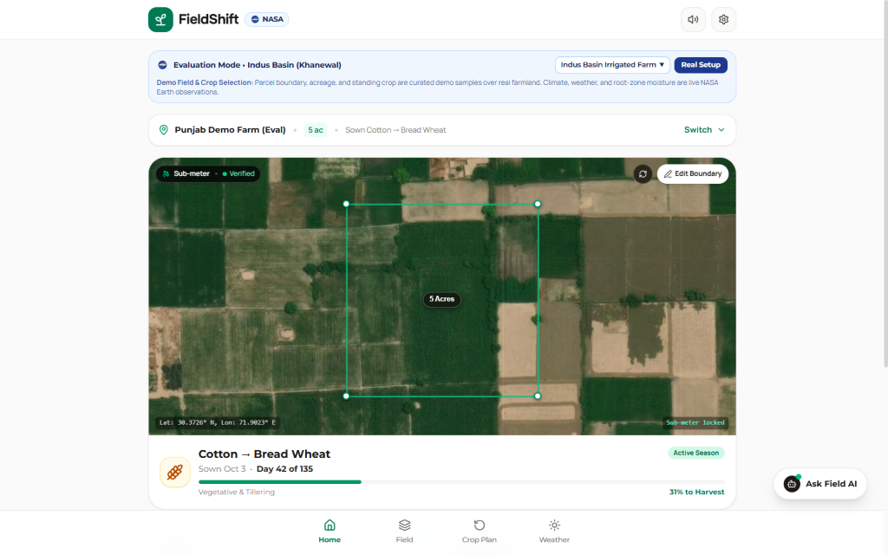
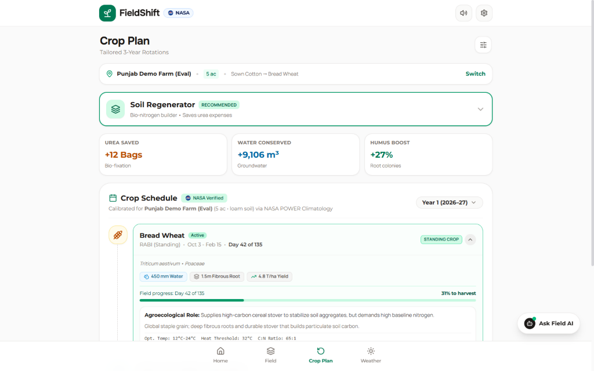
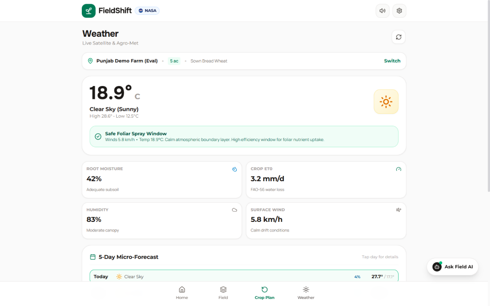
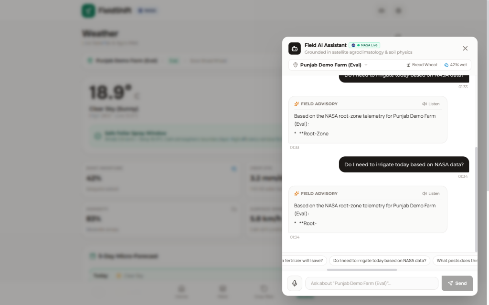

<div align="center">


# FieldShift
### 24/7 Satellite Farm Intelligence & Crop Rotation Platform

> *"Your farm needs 24/7 surveillance and crop rotation to restore and improve the soil. Our app is here."*

<a href="https://www.spaceappschallenge.org/" target="_blank" rel="noopener noreferrer"></a>
<a href="https://field-shift-green.vercel.app" target="_blank" rel="noopener noreferrer"></a>
<a href="https://github.com/Hamidcodedot/FieldShift/releases/latest" target="_blank" rel="noopener noreferrer"></a>

<br />


<br /><br />

<a href="https://field-shift-green.vercel.app" target="_blank" rel="noopener noreferrer"><strong>Launch Live App</strong></a> &nbsp;•&nbsp;
<a href="https://github.com/Hamidcodedot/FieldShift/releases/latest" target="_blank" rel="noopener noreferrer"><strong>Download Android APK (v1.0.0)</strong></a> &nbsp;•&nbsp;
<a href="https://github.com/Hamidcodedot/FieldShift" target="_blank" rel="noopener noreferrer"><strong>Explore Source Code</strong></a>

</div>

---

## Why FieldShift?

Farmers worldwide confront shifting thermal regimes, erratic rainfall, depleted aquifers, and degraded soil biology. Continuous monocropping (such as Rice–Wheat in the Indo-Gangetic Plains or Corn–Soy in the US Midwest) accelerates subsoil compaction, soil organic carbon (SOC) loss, and pest vulnerability.

| Traditional Monocropping | FieldShift + NASA Earth Observations |
| :--- | :--- |
| **Blind Irrigation:** Guessing water needs without root-zone visibility | **NASA `GWETROOT` Calibration:** Balances crop water demand against 0–100 cm root-zone wetness and precipitation |
| **Synthetic Nitrogen Dependency:** Rising urea costs & nitrate runoff | **Biological Nitrogen Fixation:** Multi-season legume rotations modeled to replenish soil nitrogen ($\Delta N$ kg/ha) |
| **Recurring Pest & Fungal Cycles:** Yield loss from repeated plant families | **Botanical Family Alternation:** Automated alerts and solver constraints break Take-all, rootworm, and nematode cycles |
| **Generic, Static Advice:** One-size-fits-all seasonal pamphlets | **24/7 AI Senior Agronomist:** Gemini 2.5 Flash grounded in your exact GPS field, sowing date, soil, and NASA telemetry (with offline fallback) |

---

## Platform Preview (Live App Screenshots)

<table>
  <tr>
    <td align="center" width="50%">
      
      <br />
      <sub><strong>1. Satellite Field Surveillance & Telemetry</strong></sub>
    </td>
    <td align="center" width="50%">
      
      <br />
      <sub><strong>2. Multi-Objective 3-Year Crop Rotation & Calendar</strong></sub>
    </td>
  </tr>
  <tr>
    <td align="center" width="50%">
      
      <br />
      <sub><strong>3. Live 5-Day Agro-Weather & Spray Advisory</strong></sub>
    </td>
    <td align="center" width="50%">
      
      <br />
      <sub><strong>4. AI Senior Agronomist (NASA & Field Grounded)</strong></sub>
    </td>
  </tr>
</table>

---

## How NASA Earth Data Powers FieldShift

FieldShift queries the **NASA POWER API v2** (`climatology/point`, Agroclimatology `AG` community) with `0.5°` spatial grid snapping and `localStorage` caching, falling back automatically to 23 calibrated regional baselines when offline.

| NASA POWER Parameter | Physical Measurement | How FieldShift Uses It |
| :--- | :--- | :--- |
| `GWETROOT` | Root-zone soil wetness (0–100 cm) | Calibrates Water Resilience Index (WRI) & flags moisture-deficit irrigation risks |
| `PRECTOTCORR` | Bias-corrected precipitation | Computes seasonal water balance against crop water requirements |
| `T2M`, `T2M_MAX`, `T2M_MIN` | 2-meter air temperature (mean, max, min) | Evaluates thermal suitability & heat-stress penalties across growing seasons |
| `ALLSKY_SFC_SW_DWN` | All-sky surface shortwave downward irradiance | Models solar radiation availability for crop biomass & growth duration |
| `RH2M`, `WS10M`, `TS` | Relative humidity, 10m wind speed, earth skin temp | Enriches agroclimatology profiling & evapotranspiration context |

---

## Core Capabilities

* **GPS Field Mapping & Multi-Field Management:** Guided onboarding wizard, automatic GPS location detection, reverse geocoding, interactive Leaflet satellite map with custom polygon boundary drawing, and multi-field profile management.
* **Multi-Objective Rotation Solver:** Generates and compares **3 optimized 3-year / 6-season strategies** (*Soil Regenerator*, *Drought & Climate Shield*, *Balanced Market & Food Security*) plus an interactive **Custom Rotation Builder** across **21 calibrated crops**.
* **Operational Crop Calendar & Live Weather:** Tracks current phenological growth stages from sowing date, planting/harvest windows, and live 5-day / 7-day agricultural weather forecasts via **Open-Meteo**.
* **AI Senior Agronomist & Voice Assistant:** Powered by **Google Gemini 2.5 Flash** via a secure Vercel Serverless backend (`/api/chat`) with automatic offline-first deterministic fallback and native Android Speech Recognition / Text-to-Speech.

---

## Multi-Objective Optimization & Architecture

FieldShift formulates crop rotation as a constrained multi-objective optimization problem:

$$\max \; J(X) = w_S \cdot \text{SHI}(X) + w_W \cdot \text{WRI}(X) + w_E \cdot \text{ESI}(X) - w_R \cdot \text{CRP}(X)$$

Where **SHI** is Soil Health Index, **WRI** is Water Resilience Index, **ESI** is Economic Security Index, and **CRP** is Climate Risk Penalty.

<details>
<summary><strong>View Full System Architecture Diagram</strong></summary>

```
[ GPS Auto-Location / Interactive Map / Field Boundary ]
                       │
                       ▼
┌─────────────────────────────────────────────────────────────┐
│                 NASA Earth Data Pipeline                    │
│  • NASA POWER API v2 (Climatology Point, AG Community)      │
│  • Variables: T2M, T2M_MAX, T2M_MIN, PRECTOTCORR,           │
│    GWETROOT (Root-Zone Wetness), ALLSKY_SFC_SW_DWN,         │
│    RH2M, WS10M, TS                                          │
│  • Grid Quantization: 0.5° Centroids + LocalStorage Cache   │
│  • Open-Meteo Forecast API: Live 5-Day & 7-Day Agro Weather │
└──────────────────────────────┬──────────────────────────────┘
                               │
                               ▼
┌─────────────────────────────────────────────────────────────┐
│          Agronomic & Soil Health Invariant Engine           │
│  • Botanical Family Alternation (Pest / Fungal Disruption)  │
│  • Biological Nitrogen Fixation (BNF) Stoichiometry         │
│  • Crop Water Demand vs. Root-Zone Moisture Balance         │
│  • Soil Organic Carbon (SOC) Accrual Modeling               │
│  • Extreme Heat & Drought Risk Penalties                    │
└──────────────────────────────┬──────────────────────────────┘
                               │
                               ▼
┌─────────────────────────────────────────────────────────────┐
│           Multi-Objective Optimization Solver               │
│  • Strategy 1: Soil Regenerator & Nitrogen Builder          │
│  • Strategy 2: Drought & Climate Resilience Shield          │
│  • Strategy 3: Balanced High-Value Market & Food Security   │
│  • Strategy 4: Interactive Custom Rotation Builder          │
└──────────────────────────────┬──────────────────────────────┘
                               │
                               ▼
┌─────────────────────────────────────────────────────────────┐
│           Decision Support & Advisory Interface             │
│  • Guided Onboarding & Multi-Field Management               │
│  • Satellite Map Viewport & Custom Field Boundary Drawing   │
│  • Live 5-Day Agricultural Weather & Soil Health Diagnostics│
│  • 3-Year / 6-Season Rotation Matrix & Operational Calendar │
│  • AI Senior Agronomist (/api/chat + Gemini 2.5 Flash)      │
└─────────────────────────────────────────────────────────────┘
```

</details>

---

## Production Tech Stack

| Layer | Technology |
| :--- | :--- |
| **Frontend** | React 19, TypeScript, Vite, Tailwind CSS v4, Lucide React |
| **Geospatial** | Leaflet (Esri World Imagery / OpenStreetMap, optional Google Satellite Hybrid & Terrain) |
| **AI Backend** | Vercel Serverless Function (`/api/chat`) + Google Gemini 2.5 Flash + Offline Deterministic Fallback |
| **Mobile** | Capacitor 8 Android (`org.fieldshift.app`) with native Speech Recognition & Text-to-Speech |
| **Earth & Weather APIs** | NASA POWER REST API v2, Open-Meteo Forecast API |

---

## Local Setup & Build

<details>
<summary><strong>Installation, Environment Variables & Android Sync Instructions</strong></summary>

### Prerequisites
- Node.js 18+ (tested on Node v24) & npm 9+
- Android Studio / JDK 17+ *(optional, for building the Android APK)*

### Quickstart

```bash
# 1. Clone repository
git clone https://github.com/Hamidcodedot/FieldShift.git
cd FieldShift

# 2. Install dependencies
npm install

# 3. (Optional) Configure environment variables
cp .env.example .env
# Add VITE_GOOGLE_MAPS_API_KEY for optional Google Satellite Hybrid/Terrain layers
# Set GEMINI_API_KEY in Vercel Environment Variables for /api/chat

# 4. Launch development server
npm run dev
```

### Production Build & Android Sync

```bash
# Build web bundle
npm run build
npm run preview

# Sync web bundle to Android Capacitor project
npx cap sync android
```

</details>

---

## Scientific Grounding & References

- **NASA POWER Project:** Agroclimatology Archive, NASA Langley Research Center (`T2M`, `T2M_MAX`, `T2M_MIN`, `PRECTOTCORR`, `GWETROOT`, `ALLSKY_SFC_SW_DWN`, `RH2M`, `WS10M`, `TS`).
- **NASA MERRA-2:** Modern-Era Retrospective analysis for Research and Applications, Version 2 (underlying NASA POWER meteorology).
- **NASA SMAP:** Soil Moisture Active Passive root-zone soil moisture reference.
- **Open-Meteo:** High-resolution agricultural weather & soil moisture forecast API.
- **FAO-56:** Allen, R. G., et al. *Crop evapotranspiration - Guidelines for computing crop water requirements*.
- **RothC-26.3:** Coleman, K. & Jenkinson, D. S. *A model for the turnover of carbon in soil*.

---

<div align="center">

Built with dedication for the **2026 NASA International Space Apps Challenge**  
<a href="https://field-shift-green.vercel.app" target="_blank" rel="noopener noreferrer">Live Web App</a> &nbsp;•&nbsp;
<a href="https://github.com/Hamidcodedot/FieldShift/releases/latest" target="_blank" rel="noopener noreferrer">Android APK v1.0.0</a> &nbsp;•&nbsp;
<a href="https://github.com/Hamidcodedot/FieldShift" target="_blank" rel="noopener noreferrer">GitHub Repository</a>

</div>
