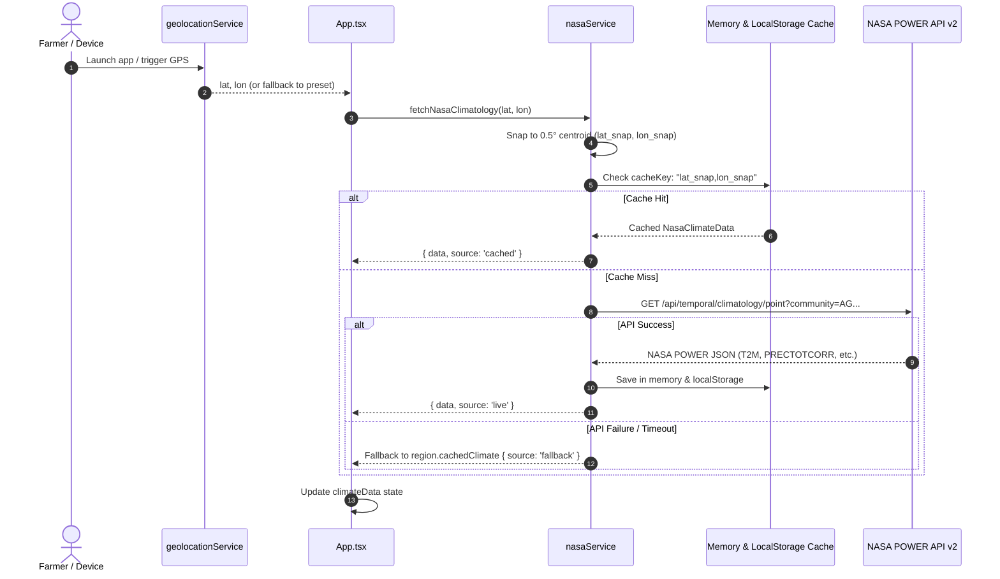
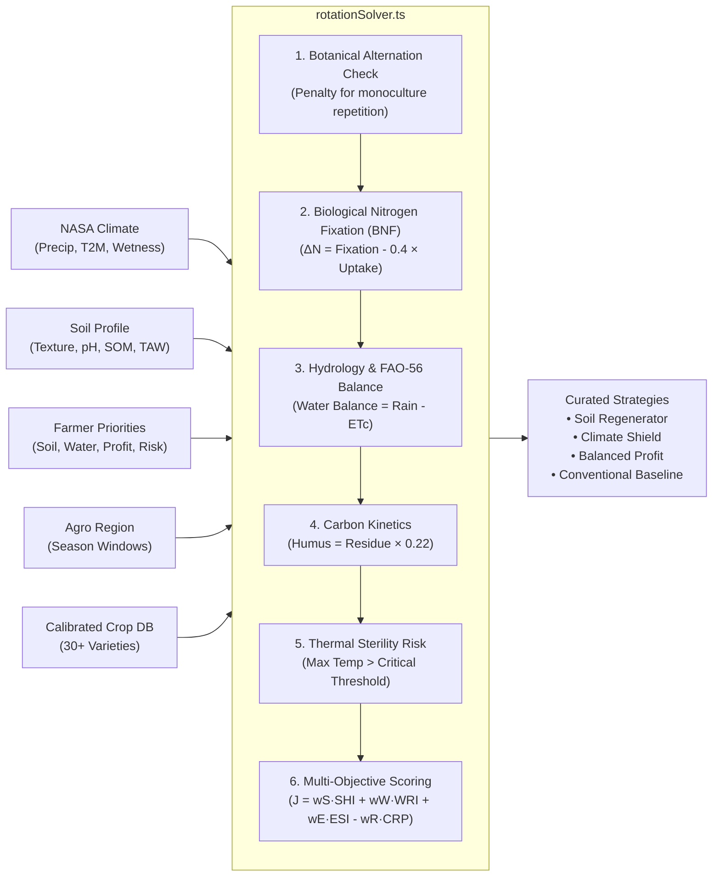

# Architecture and Data Flow

> **Document Status:** Technical Reference  
> **Target Scope:** System Architecture, Data Pipelines, State Lifecycle & Algorithmic Invariants

---

## 1. System Architecture Overview

The FieldShift application follows a unidirectional, reactive data flow architecture. The root state in `App.tsx` serves as the single source of truth, synchronizing geospatial coordinates, NASA Earth Observations, soil physics parameters, and farmer priority weights into the agronomic optimization engine.

```mermaid
flowchart TD
    subgraph ClientLayer["Client Layer (PWA / Android Native)"]
        UI_Head["Header & Controls"]
        Tab_Home["FarmerHomeTab"]
        Tab_Field["FarmerFieldTab (MapSelector + Soil)"]
        Tab_Rot["StrategyComparison + TimelineGantt"]
        Tab_Voice["VoiceAssistantTab"]
        Modal_Custom["CustomRotationBuilder"]
        Modal_Export["ExportModal"]
    end

    subgraph StateHub["App.tsx State Controller"]
        State_Coord["Coordinates (Lat, Lon)"]
        State_Region["Selected AgroRegion"]
        State_Climate["NasaClimateData"]
        State_Soil["SoilProfile"]
        State_Prio["FarmerPriorities"]
        State_Strat["Active & Curated Strategies"]
        State_Theme["ChaiUI Theme (Light/Dark)"]
    end

    subgraph ServiceLayer["Services & External APIs"]
        S_NASA["nasaService.ts\n(NASA POWER API v2)"]
        S_Geo["geolocationService.ts\n(GPS Coordinates)"]
        S_RevGeo["reverseGeocodeService.ts\n(OSM Nominatim)"]
        S_Voice["voiceAssistant.ts\n(Capacitor STT/TTS)"]
        S_Map["mapConfigService.ts\n(Leaflet Tiles)"]
    end

    subgraph EngineLayer["Core Agronomic Solver"]
        E_Solver["rotationSolver.ts\n(Multi-Objective Optimization)"]
        D_Crops["crops.ts (30+ Crop Varieties)"]
        D_Regions["regions.ts (6 Macro-Regions)"]
    end

    %% State to UI
    StateHub --> ClientLayer

    %% User Input to State
    Tab_Field -->|Coordinates & Soil| StateHub
    Tab_Rot -->|Strategy Selection| StateHub
    Modal_Custom -->|Custom Crop Slots| StateHub
    UI_Head -->|Region, Theme| StateHub

    %% Services to State
    S_Geo -->|GPS Initial Lat/Lon| StateHub
    S_RevGeo -->|Human Location Name| Tab_Field
    S_NASA -->|Climatology Data| StateHub
    Tab_Voice <--> S_Voice

    %% Engine to State
    State_Region & State_Climate & State_Soil & State_Prio --> E_Solver
    D_Crops & D_Regions --> E_Solver
    E_Solver -->|Curated 4 Archetypes| State_Strat
```

---

## 2. Core Data Pipelines

### Pipeline A: Geospatial Coordinate & NASA Climate Pipeline

---

### Pipeline B: Agronomic Optimization Solver Pipeline

---

## 3. Mathematical & Agronomic Formulations

### 1. Biological Nitrogen Fixation (BNF) Stoichiometry
Leguminous crops (e.g., chickpea, moong, cowpea, pigeon pea, soybean) form symbiotic relationships with *Rhizobium* bacteria to fix atmospheric nitrogen:
$$\Delta N_{\text{season}} = N_{\text{fixation}} - (N_{\text{uptake}} \times 0.4)$$
- A positive balance contributes to residual soil nitrogen for the subsequent cereal crop.
- Reduces mineral nitrogen (urea) synthetic fertilizer requirements by up to 60–80 kg/ha.

### 2. Hydrological Soil Water Balance
For each seasonal crop slot $i$:
$$P_{\text{eff}} = \sum_{m=1}^{D} \text{PRECTOTCORR}_m$$
$$\text{Water Balance}_i = P_{\text{eff}} - ET_{c, i}$$
Where:
- $P_{\text{eff}}$ is the aggregate NASA POWER precipitation over the crop growth window.
- $ET_{c, i} = K_{c, i} \times ET_{0}$ is the crop water consumption.
- If $\text{Water Balance}_i < -200\text{ mm}$ under a rainfed regime, a severe water stress penalty is applied to the Climate Risk Penalty ($CRP$).

### 3. Soil Organic Carbon (SOC) Accrual
Soil humus synthesis from post-harvest crop residues follows first-order humification kinetics:
$$\Delta C_{\text{humus}} = \text{Residue}_{\text{ton/ha}} \times \eta_{\text{humification}}$$
Where $\eta_{\text{humification}} = 0.22$ based on calibrated RothC-26.3 soil turnover models.

### 4. Thermal Sterility Penalty
During the reproductive anthesis phase of flowering crops:
$$\text{Risk}_{\text{thermal}} = \begin{cases} 45 & \text{if } T_{\text{max, peak}} > T_{\text{critical}} \\ 0 & \text{otherwise} \end{cases}$$
For example, wheat experiences rapid pollen sterility and grain abortion when temperatures exceed $35^\circ\text{C}$ during grain-filling.

---

## 4. State Management Lifecycle in `App.tsx`

| State Variable | Type | Trigger / Source | Dependents |
| :--- | :--- | :--- | :--- |
| `selectedLat`, `selectedLon` | `number` | GPS detection, map click, or region preset | Triggers `fetchNasaClimatology`, reverse geocoding |
| `currentRegion` | `AgroRegion` | Region dropdown, GPS nearest match | Triggers solver recalculation, default soil update |
| `climateData` | `NasaClimateData` | `nasaService.ts` API response | Triggers solver recalculation, climate dashboard |
| `soil` | `SoilProfile` | Sliders in `FarmerFieldTab` | Triggers solver recalculation |
| `priorities` | `FarmerPriorities` | Sliders in `FarmerFieldTab` | Triggers solver recalculation |
| `strategies` | `Record<...>` | Recalculated by `useEffect` on any input change | Updates `StrategyComparison`, `TimelineGantt`, and `ExportModal` |
| `activeStrategy` | `RotationStrategy` | User click on strategy card or custom builder save | Renders in `TimelineGantt`, `FarmerHomeTab`, and `ExportModal` |
| `theme` | `'light' \| 'dark'` | Header theme toggle button | Toggles `.dark` class on root HTML document |

---

## 5. Architectural Invariants

1. **Input Neutrality:** The system does not promote proprietary seeds, chemical pesticides, or specific commercial fertilizer brands. All recommendations are grounded in open science and regenerative agro-ecology.
2. **Offline Resilience:** The app operates fully without an active internet connection by using pre-warmed 30-year climatology baselines and local storage.
3. **Zero AI Slop & Emoji-Free Interface:** The UI strictly adheres to high-contrast scientific minimalism, 1px hairlines, and SVG iconography (Lucide).
4. **Mobile Native Ergonomics:** All primary interactive controls are situated within the lower thumb-reach zone to accommodate field usage on mobile Android devices.
