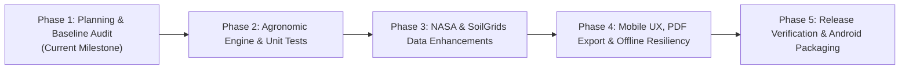

# Strategic Roadmap and Implementation Plan

> **Document Status:** Planning & Execution Roadmap  
> **Target Milestone:** Post-Audit Phased Development & Submission Hardening  
> **Protocol:** Every item must have an approved specification in `planning/` before code is written.

---

## 1. Gap Analysis: Current State vs. Next Frontiers

While the core FieldShift platform is fully functional with live NASA POWER data, multi-objective rotation optimization, an interactive sandbox, multilingual voice support, and an Android APK build, the following high-impact gaps and opportunities exist:

| Focus Area | Current Implementation | Planned Enhancement | Priority |
| :--- | :--- | :--- | :--- |
| **Engine Testing** | Visual validation in UI | Formal unit tests (`vitest`) for `rotationSolver.ts` checking mathematical bounds and invariant penalties | **High** |
| **Direct PDF Export** | Uses `window.print()` browser dialog | Client-side direct PDF generation (e.g. `jspdf` / `html2canvas`) tailored for mobile file saving | **Medium** |
| **SoilGrids REST API** | Pre-warmed soil profiles in macro-regions | Live integration with ISRIC SoilGrids 250m REST API using user GPS coordinates | **High** |
| **Daily Weather & ET0** | 12-Month climatological averages | Short-term 7-day agro-meteorological forecast via Open-Meteo Agro API (FAO-56 reference evapotranspiration) | **Medium** |
| **Offline Map Tiles** | Online Leaflet tiles (OSM / Google) | Offline vector tile caching or localized fallback bounding canvas for zero-coverage remote fields | **Medium** |
| **Voice AI Depth** | Pattern-matched rule intent parser | Structured agronomy knowledge base expansion with natural conversational queries | **Medium** |
| **Crop Database Growth** | 30 calibrated crops | Expansion to 50+ localized varieties including regional millets, cover crops, and forage legumes | **Low** |

---

## 2. Phased Development Roadmap

---

### Phase 1: Planning, Documentation & Baseline Audit (Complete)
- [x] Create dedicated `planning/` workspace.
- [x] Document complete audit of existing codebase (`01_CURRENT_BUILD_STATE.md`).
- [x] Create comprehensive architectural blueprints and data flow diagrams (`02_ARCHITECTURE_AND_DATA_FLOW.md`).
- [x] Establish feature specification guidelines (`04_FEATURE_SPEC_TEMPLATE.md`).
- [x] Map out priority roadmap and transition gates.

---

### Phase 2: Agronomic Engine Rigor & Automated Testing
**Objective:** Guarantee mathematical correctness and prevent regressions across multi-season rotation calculations.

- [ ] **Task 2.1:** Configure `vitest` for the project.
- [ ] **Task 2.2:** Write automated unit tests for `rotationSolver.ts`:
  - Test botanical family alternation penalty (verify score drop when Poaceae follows Poaceae).
  - Test Biological Nitrogen Fixation calculations across legume vs. cereal sequences.
  - Test FAO-56 hydrological water balance against extreme precipitation variations.
  - Test thermal sterility risk trigger when $T_{\text{max}} > T_{\text{critical}}$.
- [ ] **Task 2.3:** Calibrate economic gross margin formulas with inflation-adjusted commodity baselines.

---

### Phase 3: Earth Observations & SoilGrids API Expansion
**Objective:** Elevate data fidelity by combining NASA POWER with live 250m resolution soil physics.

- [ ] **Task 3.1:** Implement live client for **ISRIC SoilGrids REST API**:
  - Query clay, silt, sand fractions, organic carbon density (SOC), and cation-exchange capacity (CEC) at user coordinates.
  - Seamless fallback to current regional presets if SoilGrids is unreachable.
- [ ] **Task 3.2:** Integrate **Open-Meteo Agro API**:
  - Fetch 7-day FAO-56 reference evapotranspiration ($ET_0$) forecast.
  - Display immediate weekly irrigation advisory alerts on the `FarmerHomeTab`.
- [ ] **Task 3.3:** Add visual NDVI / Vegetation Health timeline indicator using NASA MODIS/VIIRS climatology composites.

---

### Phase 4: Mobile UX, Field PDF Generation & Offline Hardening
**Objective:** Maximize smallholder farmer usability in remote rural environments.

- [ ] **Task 4.1:** Client-side Action Plan PDF download:
  - Format a standalone, multi-page field action brief with crisp vector charts and seasonal schedules.
  - Allow farmers to save the PDF directly to Android device storage without requiring an active printer.
- [ ] **Task 4.2:** IndexedDB / Offline Cache Synchronization:
  - Cache recent NASA queries and custom rotations inside IndexedDB for seamless offline resumption.
  - Add offline status indicator with manual refresh capability.
- [ ] **Task 4.3:** Urdu typography polish:
  - Audit all translated strings in `translations.ts` for natural phrasing and correct RTL text wrapping on narrow mobile screens.

---

### Phase 5: Submission Packaging & Production Release
**Objective:** Finalize build artifacts, documentation, and video demonstration for the NASA Space Apps Challenge.

- [ ] **Task 5.1:** Re-compile Android APK with latest optimizations and verify all permissions on hardware.
- [ ] **Task 5.2:** Verify clean production web build (`npm run build`).
- [ ] **Task 5.3:** Finalize executive submission summary and video script showcasing the live NASA data integration.

---

## 3. Gating Protocol Before Implementation

Before any developer or agent begins writing code for a new feature:
1. **Spec Required:** A corresponding specification file must be drafted in `planning/` using `04_FEATURE_SPEC_TEMPLATE.md`.
2. **Scientific Validation:** Any formula modifications must cite authoritative sources (e.g., FAO, USDA, Rothamsted, NASA).
3. **Zero Breakage Verification:** `npm run build` and `npm run lint` must pass with zero errors on the active branch prior to merging.
