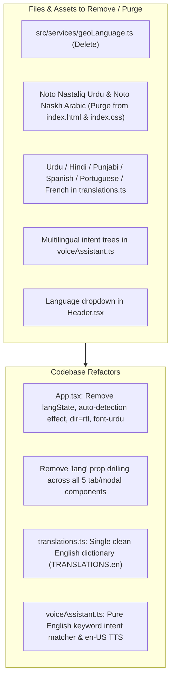

# Feature Specification: Language Simplification (English Only)

> **Specification Status:** Implemented & Verified  
> **Target Scope:** Simplification & De-bloating  
> **Author:** Antigravity / Engineering  
> **Date:** 2026-10-28  

---

## Verification Summary
- [x] `src/services/geoLanguage.ts` safely removed without dangling imports.
- [x] `index.html` and `src/index.css` purged of unused Nastaliq/Arabic font links and CSS.
- [x] Header renders cleanly without language dropdown.
- [x] Voice Assistant operates in English with `en-US` STT and TTS.
- [x] `npm run build` compiles with 0 errors (bundle reduced by ~43 kB).
- [x] `npm run lint` passes with 0 errors.  

---

## 1. Problem Statement & Motivation

The previous build implemented a 7-language multilingual subsystem:
- English, Urdu, Hindi, Punjabi, Spanish, Portuguese, and French.
- Coordinate-based language auto-detection (`geoLanguage.ts`).
- Complex RTL (Right-to-Left) rendering rules and external Nastaliq calligraphy font payloads (`Noto Nastaliq Urdu`, `Noto Naskh Arabic`) totaling hundreds of kilobytes in network requests and heavy CSS overrides.
- Multi-language regex keyword trees across `voiceAssistant.ts`.
- 600+ lines of duplicated translation dictionaries in `translations.ts`.

**Why Simplify?**
This level of localization is an exaggeration for the NASA Space Apps Challenge core objective (which evaluates Earth science data integration, agronomic modeling, and decision-support ergonomics). It creates unnecessary maintenance friction, layout alignment regressions, and bloat. 

We will remove all languages except **English**, establishing English as the sole default language across the entire platform.

---

## 2. Planned Changes & Module Impact

### Detailed Component Inventory:

1. **`index.html`:**
   - Remove Google Font imports for `Noto+Nastaliq+Urdu` and `Noto+Naskh+Arabic`.
   - Retain modern sans-serif typography (`Manrope`, `Montserrat`, `Onest`).

2. **`src/index.css`:**
   - Remove `--font-urdu` variable declaration.
   - Remove all `.font-urdu` classes and typography override blocks.

3. **`src/data/translations.ts`:**
   - Set `Language = 'en'`.
   - Retain only `TRANSLATIONS.en` for UI strings.
   - Clean up `CROP_LOCALIZED_NAMES` to standard names or remove multi-language mapping.
   - Keep `SUPPORTED_LANGUAGES` containing only English (or remove unused language metadata).

4. **`src/services/geoLanguage.ts`:**
   - Remove or deprecate this service completely.

5. **`src/services/voiceAssistant.ts`:**
   - Retain clean English keyword matching for crop sequencing, drought/water conservation, fertilizer reduction, and soil restoration.
   - Remove Urdu, Hindi, Punjabi, Spanish, Portuguese, and French translation blocks.
   - Fix TTS voice target permanently to `'en-US'`.

6. **`src/components/Header.tsx`:**
   - Remove language `<select>` dropdown and auto-detection badge.
   - Retain Theme toggle, Region selector, and Export Action button.

7. **`src/App.tsx`:**
   - Remove `langState`, `getInitialLanguage`, and `detectLanguageFromCoordinates`.
   - Remove `dir={lang === 'ur' ? 'rtl' : 'ltr'}` and `${lang === 'ur' ? 'font-urdu' : ''}`.
   - Stop prop-drilling `lang` to child components.

8. **Child Components (`BottomNavigation`, `FarmerHomeTab`, `FarmerFieldTab`, `StrategyComparison`, `VoiceAssistantTab`):**
   - Remove `lang: Language` from prop interfaces.
   - Directly read from English translations dictionary.

---

## 3. Verification & Acceptance Criteria
- [ ] `src/services/geoLanguage.ts` safely removed without dangling imports.
- [ ] `index.html` and `src/index.css` purged of unused Nastaliq/Arabic font links and CSS.
- [ ] Header renders cleanly without language dropdown.
- [ ] Voice Assistant works smoothly in English with `en-US` STT and TTS.
- [ ] `cmd.exe /c npm run build` compiles with 0 errors.
- [ ] `cmd.exe /c npm run lint` passes with 0 errors.
