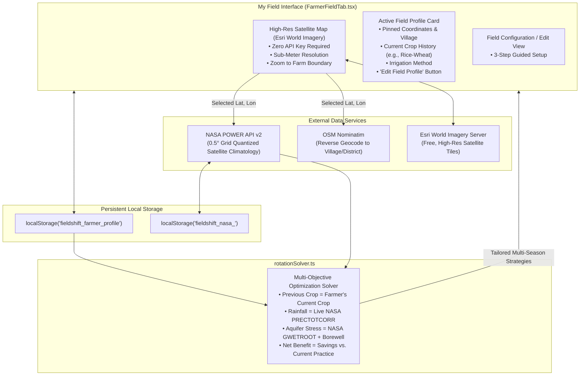

# Feature Specification: High-Resolution Satellite Field Selector & Field-Grounded Rotation Engine

> **Specification Status:** Implemented & Verified  
> **Target Scope:** Map Layer Overhaul, Field Profile Onboarding, NASA Satellite Grounding  
> **Author:** Antigravity / Engineering  
> **Date:** 2026-10-28  

---

## 1. Problem Statement & User Requirements

The user identified three critical issues and feature requirements:
1. **Map Watermark Bug:** The map currently displays `"API KEY REQUIRED carto.com/basemaps/apikey"` because the default tile provider (CARTO Voyager) now enforces API keys. Farmers cannot see their fields clearly.
2. **"My Field" Profile Configuration (First-Time Setup, Editable Later):**
   - The farmer must be able to pinpoint their exact field location on a high-resolution satellite map.
   - The farmer must specify what they are **currently growing** (current crop rotation / history, e.g., Rice–Wheat, Corn–Soy, Cotton–Wheat).
   - The farmer must specify **how they irrigate** (Tubewell / Canal / Rainfed / Drip).
   - These settings must be saved persistently on first use, but remain easily editable at any time.
3. **NASA Satellite-Grounded Recommendations:**
   - The rotation solver must not use generic baselines; it must explicitly calculate recommendations based on the **specific field coordinates selected** and the **actual satellite data provided by NASA** (NASA POWER / MERRA-2 precipitation, root-zone soil wetness `GWETROOT`, temperature curves).
   - The recommended rotation must explicitly transition the farmer away from their **current crop rotation**, calculating real nitrogen savings, disease cycle disruption, and groundwater conservation relative to what they actually farm today.

---

## 2. Architectural Blueprint & Data Flow



---

## 3. Detailed Component & Service Specifications

### 3.1. Zero-Config High-Resolution Satellite Map (`mapConfigService.ts` & `MapSelector.tsx`)
- **Eliminate CARTO tiles completely.**
- **Default Active Layer:** `'satellite'` (High-Resolution Esri World Imagery).
- **Satellite Tile Endpoint:**
  ```typescript
  url: 'https://server.arcgisonline.com/ArcGIS/rest/services/World_Imagery/MapServer/tile/{z}/{y}/{x}',
  attribution: '&copy; Esri &copy; Maxar, Earthstar Geographics, CNES/Airbus DS',
  maxZoom: 19
  ```
  - **No API key needed.**
  - **Zero watermarks.**
  - Allows farmers to clearly see crop fields, field boundaries, farm tracks, and tubewell sheds globally up to zoom level 19.
- **Clean Standard Tile Endpoint (Fallback/Toggle):**
  ```typescript
  url: 'https://tile.openstreetmap.org/{z}/{x}/{y}.png',
  attribution: '&copy; OpenStreetMap contributors',
  maxZoom: 19
  ```

---

### 3.2. Data Model: `FarmerFieldProfile` (`src/types/index.ts`)
```typescript
export interface FarmerFieldProfile {
  isConfigured: boolean;
  farmName: string;
  placeName: string; // Human-readable village/tehsil/district
  latitude: number;
  longitude: number;
  nasaGridCentroid: { lat: number; lon: number };
  currentCropHistory: {
    previousCropId: string; // e.g. 'rice', 'corn', 'cotton'
    currentCropId: string;  // e.g. 'wheat', 'soybean', 'fallow'
    patternLabel: string;   // e.g. 'Rice – Wheat (Continuous Monoculture)'
  };
  irrigationMethod: 'groundwater_borewell' | 'canal_surface' | 'rainfed' | 'drip_precision';
  soilTexture: 'loam' | 'clay' | 'sandy_loam';
  soilOrganicMatter: number; // e.g. 1.2%
}
```

---

### 3.3. UX Flow: First-Time Setup vs. Editable Later (`FarmerFieldTab.tsx`)
1. **First-Time Farmer Experience:**
   - If `fieldProfile.isConfigured === false`:
     - The "My Field" tab presents a clear, welcoming **"Set Up Your Field Profile"** wizard directly integrated into the page.
     - **Step 1:** Pinpoint location on the satellite map (or tap 1-touch **"Locate My Field (GPS)"**). The app auto-detects the village name via reverse geocoding.
     - **Step 2:** Select current crop pattern:
       - Presets for regional realities:
         - *Rice ➔ Wheat* (Intensive Cereal Monoculture)
         - *Corn ➔ Soy* (Midwest Continuous Rotation)
         - *Cotton ➔ Wheat* (Cash Crop + Cereal)
         - *Pearl Millet / Sorghum ➔ Fallow* (Dryland Rainfed)
         - *Custom Crop Pair*
     - **Step 3:** Select irrigation source (Borewell / Canal / Rainfed / Drip) and soil texture (Loam / Clay / Sandy).
     - Tap **"Save Field Profile & Generate NASA Plan"**.
2. **Subsequent Visits (Editable Later):**
   - The tab displays an **Active Field Summary Card**:
     - Visual badge: `Active Field • [Village Name]`
     - Coordinates and NASA 0.5° Grid Centroid indicator
     - Current Practice: e.g., *"Rice ➔ Wheat with Borewell Irrigation"*
     - Detected Soil: e.g., *"Loam Soil • Low Organic Matter"*
     - Action Button: **"Edit Field Profile"** (instantly reopens the configuration drawer to adjust any setting).
   - Saved automatically in `localStorage.setItem('fieldshift_farmer_profile', ...)`.

---

### 3.4. Grounding Recommendations in NASA Satellite Data (`rotationSolver.ts`)
The rotation solver will now take `FarmerFieldProfile` directly into account:
1. **Initial Disease & Pest Invariant:**
   - If the farmer is currently growing `wheat` and the proposed season 1 is also a *Poaceae* cereal (wheat/barley/corn), the engine applies an immediate carryover disease risk penalty (-35 pts).
   - If the farmer is currently growing continuous `rice`, it detects hardpan subsoil compaction and prioritizes deep taproot crops (*Fabaceae* like pigeon pea or chickpea).
2. **Hydrological Water Deficit using NASA MERRA-2:**
   - Uses the live `precipitationMonthlyMm` and `rootZoneSoilMoistureMonthly` (`GWETROOT`) from NASA POWER at the exact field coordinates.
   - If the farmer uses `groundwater_borewell` in a region where NASA root-zone moisture is $< 0.35$, the engine calculates exact cubic meters ($m^3$) of groundwater pumped and prioritizes drought-hardy legumes to conserve aquifer reserves.
3. **Transparent Satellite Rationale Banner:**
   - In `StrategyComparison.tsx` and `FarmerHomeTab.tsx`, show an explicit scientific diagnosis:
     > *"Based on NASA POWER observations for your field at **[Village, Lat/Lon]** (Annual Rain: **[X] mm**, Root Moisture: **[Y]%**) and your current **[Rice-Wheat]** rotation, transitioning to **[Soil Restorer]** will save **[Z] bags of urea** and **[W] m³ groundwater**."*

---

## 4. Implementation Steps & Checklist

- [x] **Step 1:** Fix [mapConfigService.ts](file:///z:/Nasa-Space-App/src/services/mapConfigService.ts) to remove CARTO tiles. Set default layer to Esri World Imagery (Satellite) and OpenStreetMap (Standard).
- [x] **Step 2:** Add `FarmerFieldProfile` interface to [src/types/index.ts](file:///z:/Nasa-Space-App/src/types/index.ts).
- [x] **Step 3:** Create field profile persistence helper in [src/services/fieldProfileService.ts](file:///z:/Nasa-Space-App/src/services/fieldProfileService.ts).
- [x] **Step 4:** Overhaul [FarmerFieldTab.tsx](file:///z:/Nasa-Space-App/src/components/FarmerFieldTab.tsx) with the satellite map, field profile card, current rotation picker, and "Edit Field Profile" toggle.
- [x] **Step 5:** Connect `FarmerFieldProfile` into [rotationSolver.ts](file:///z:/Nasa-Space-App/src/engine/rotationSolver.ts) to ground recommendations against the farmer's current crop baseline and NASA satellite data.
- [x] **Step 6:** Verify build (`npm run build`) and test all interactions on the satellite map.
