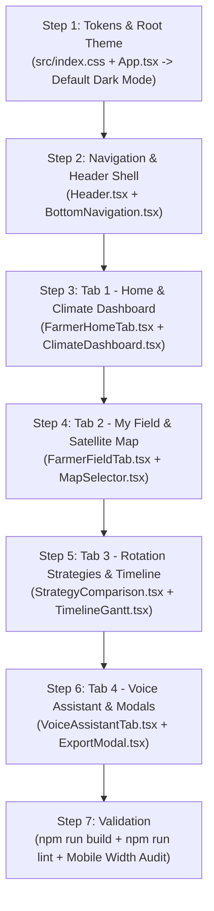

# ChaiUI & Mobile-Oriented Design Simplification Specification

> **Specification Status:** Complete (Implemented & Verified)  
> **Target Milestone:** UI/UX Polish & Mobile Refactor  
> **Design Framework:** ChaiUI (chaicode.com look)  
> **Theme Policy:** **White Default (Soothing Warm Light Canvas)**  
> **Author:** Antigravity / Engineering  
> **Date:** 2026-10-31  

---

## 1. Executive Summary & Design Vision

The user requested:
> *"we have to make the design simplify and mobile oriented properly.... /chaiui"*  
> *"color will be white default ....the soothing color"*

We are applying the **ChaiUI design system** with a **soothing warm-white default canvas**:
- **Canvas & Background:** Soothing warm white (`#fafafa` / `#fcfcfb`, gentle on the eyes with zero harsh blue glare).
- **Cards & Surfaces:** Signature ChaiUI warm hairlines (`border-amber-900/12 bg-white/80 backdrop-blur-sm`, zero drop shadows).
- **Typography & Highlights:** Manrope body, Montserrat card titles and data metrics, and exactly **one highlight phrase per paragraph** in soothing warm amber (`text-yellow-800 dark:text-orange-100`).
- **Restraint & Meaning:** Eliminating aggressive electric neon fills (`bg-emerald-700`). Color is strictly reserved for text and subtle thin outlines.
- **Buttons:** Signature ChaiUI asymmetric corners (`btn-asym` solid stone-900 on white canvas, `btn-asym-mirror` for outline).
- **Mobile Ergonomics:** Compact header (56px), fixed bottom navigation with safe-area spacing and 48px+ touch targets, simplified 2x2 KPI grids, and smooth satellite map interactions.
- **Dark Mode Support:** Fully preserved via the ChaiUI theme toggle for users who prefer near-black (`#0a0a0a`), but initial and default state is the soothing warm white.

---

## 2. ChaiUI Non-Negotiable Rules & System Invariants

According to the official **ChaiUI design system**:

```
┌────────────────────────────────────────────────────────────────────────┐
│                        CHAIUI DESIGN INVARIANTS                        │
├─────────────────┬──────────────────────────────────────────────────────┤
│ 1. Default Mode │ Dark is default: #0a0a0a (neutral greys, chroma 0).  │
│ 2. Accent Color │ Highlight cream: text-orange-100 (dark), yellow-800  │
│                 │ (light). Only for 1 highlight phrase per paragraph.  │
│ 3. Orange Rule  │ Orange is NEVER a fill. No orange buttons, badges,  │
│                 │ headings, or progress bars.                          │
│ 4. Surfaces     │ card-chai: border-orange-50/15 bg-black/10 (dark),   │
│                 │ border-amber-900/15 bg-white/70 (light). NO SHADOWS. │
│ 5. Typography   │ Manrope for UI/body, Montserrat for card titles,     │
│                 │ numbers, and highlight phrases; Onest for wordmark.  │
│ 6. Buttons      │ Solid (1 per screen): btn-asym (white on dark) with   │
│                 │ ArrowUpRight. Outline beside it: btn-asym-mirror.    │
│ 7. Copywriting  │ Sentence case, zero em dashes (--), friendly & concise│
│ 8. Mobile Erg.  │ Max width 6xl, thumb-reach bottom bar, >=48px touch. │
└─────────────────┴──────────────────────────────────────────────────────┘
```

---

## 3. Component-by-Component Mobile Simplification Plan

### 3.1. Global Styling & Theme Core (`src/index.css` & `src/App.tsx`)
- **Default Theme:** Set `dark` as the default in `App.tsx` and on the root `<html>` element.
- **Theme Variables:** Integrate the official ChaiUI tokens into `@theme inline` in Tailwind CSS v4:
  - `--background`: `oklch(0.145 0 0)` (`#0a0a0a`)
  - `--card-edge`: `rgb(255 247 237 / 0.15)` in dark, `rgb(120 53 15 / 0.15)` in light
  - `--card-fill`: `rgb(0 0 0 / 0.1)` in dark, `rgb(255 255 255 / 0.7)` in light
  - `--highlight`: `oklch(0.954 0.038 75.164)` (`orange-100`) in dark, `yellow-800` in light
- **Eliminate Colored Drop Shadows:** Enforce `box-shadow: none !important;` across all cards.
- **Page Container:** Set mobile-first container `max-w-4xl mx-auto px-4 py-3 sm:px-6` with safe-area spacing `pb-28`.

---

### 3.2. Top Header (`src/components/Header.tsx`)
- **Current Issues:** Cluttered with secondary controls; green logo background pill; export button competes with page title.
- **Mobile Simplification:**
  - Compact height (`h-14` / 56px) with clean hairline bottom border (`border-border`).
  - Wordmark: "FieldShift" in `font-brand` (Onest) with a minimal NASA text tag.
  - Right controls grouped:
    - Half-circle ChaiUI Theme Switcher (Sun/Moon).
    - Compact region selector pill (opens a clean bottom sheet / select on mobile).
    - Outline button (`btn-asym-mirror`) for Export Plan.

---

### 3.3. Bottom Navigation Bar (`src/components/BottomNavigation.tsx`)
- **Current Issues:** Has a green icon ring on the voice tab; active tab is heavy colored text.
- **Mobile Simplification:**
  - Modern bottom tab bar with `backdrop-blur-md bg-background/90 border-t border-border`.
  - Added safe area padding: `pb-[max(0.5rem,env(safe-area-inset-bottom))]`.
  - Active Tab State: Pure near-white text (`text-foreground`), subtle top indicator line or dot, and Montserrat label (`text-[10px] font-medium`).
  - Inactive Tab State: Neutral grey (`text-muted-foreground`), clean hover effect.
  - Guaranteed minimum touch target of 48x48px per tab item.

---

### 3.4. Tab 1: Farmer Home (`src/components/FarmerHomeTab.tsx` & `ClimateDashboard.tsx`)
- **Current Issues:** Too many competing elements (welcome hero, green CTA button, 4 KPI cards, active strategy banner, 12-month climate charts).
- **Mobile Simplification:**
  - **Clean Hero Section:**
    - Centered headline: *"Satellite Crop Rotation Advisory"*.
    - One highlight phrase: *"Powered by NASA Earth observations to <span className="highlight">replenish soil nitrogen</span> and protect farm income."*
    - One primary solid action button (`btn-asym`): **"View Recommended Rotation"** with `ArrowUpRight`.
  - **Mobile 2x2 Impact KPI Grid:**
    - Clean `card-chai` cards with Montserrat numbers:
      - `+X bags` Urea Saved (pure green text, no green background pill).
      - `+Y m³` Water Conserved.
      - `Z / 100` Soil Health Status.
      - `Pest Shield` Protected indicator.
  - **Streamlined Climate Dashboard (`ClimateDashboard.tsx`):**
    - Compact 3-tab segmented control (`Rainfall`, `Temperature`, `Soil Moisture`) with ChaiUI dark-brown active fill (`orange-900/40` in dark, `stone-200` in light).
    - Clean responsive bar/curve chart fitting neatly on 360px viewports without horizontal clipping.

---

### 3.5. Tab 2: My Field & Satellite Mapping (`src/components/FarmerFieldTab.tsx` & `MapSelector.tsx`)
- **Current Issues:** The 4-step configuration form is long and overwhelming on mobile.
- **Mobile Simplification:**
  - **Full-Width High-Res Satellite View:**
    - Satellite map card with `rounded-xl border border-card-edge`, height optimized for mobile (`h-64 sm:h-80`).
    - Floating 1-tap **"Locate My Field (GPS)"** button (`btn-asym`) with navigation compass icon.
  - **Compact Field Profile Summary Card:**
    - Displays pinned location, current crop rotation (*Rice - Wheat*), irrigation type, and soil texture in a clean 2-column micro-grid.
  - **Streamlined Quick-Edit Drawer / Accordion:**
    - Replaces large bulky buttons with clean segmented pill selectors for:
      - Current Rotation (Rice-Wheat, Corn-Soy, Cotton-Wheat, Millet-Fallow, Custom).
      - Irrigation (Tubewell, Canal, Rainfed, Drip).
      - Soil Texture (Loam, Clay, Sandy Loam).
    - One solid save button (`btn-asym`): **"Update Field Profile"**.

---

### 3.6. Tab 3: Crop Rotation & Strategy Comparison (`src/components/StrategyComparison.tsx` & `TimelineGantt.tsx`)
- **Current Issues:** 4 large vertical cards stacked sequentially create a massive scroll length on mobile.
- **Mobile Simplification:**
  - **Mobile Strategy Segmented Selector:**
    - Horizontal pill bar or carousel tabs: `[Soil Restorer] [Drought Shield] [Balanced Profit] [Current Practice]`.
    - Clicking a tab immediately highlights and expands that strategy's metrics in a crisp `card-chai` card.
  - **Compact Metric Breakdown:**
    - Side-by-side comparison of 3-year Nitrogen Net, Water Saved, and Soil Health.
  - **Responsive 3-Year Seasonal Timeline (`TimelineGantt.tsx`):**
    - Mobile-optimized card layout showing each of the 6 seasonal crop slots with duration, botanical family badge, and water balance.
    - Custom builder trigger: secondary outline button (`btn-asym-mirror`).

---

### 3.7. Tab 4: Voice Assistant (`src/components/VoiceAssistantTab.tsx`)
- **Current Issues:** Giant microphone button with bright red/green pulsing rings.
- **Mobile Simplification:**
  - Clean, restrained central microphone button:
    - Neutral dark surface with warm hairline border (`border-card-edge`).
    - Subtle glint or highlight ring on active speech recording.
  - Clean answer card in `card-chai` with Montserrat title and audio replay button.
  - 4 quick-tap question pills with clean 1px hairline borders and compact mobile padding.

---

## 4. Mobile Ergonomics & Typography Checklist

| Element | Mobile Target | ChaiUI Rule |
| :--- | :--- | :--- |
| **Touch Targets** | $\ge 48\text{px} \times 48\text{px}$ for buttons and tabs | No tiny unclickable targets |
| **Horizontal Scroll** | Strict `overflow-x: hidden;` on body and page wrappers | Zero horizontal scroll |
| **Header Height** | Compact $56\text{px}$ (`h-14`) | Blurs over content smoothly |
| **Font Sizing** | Headings $20\text{px} - 24\text{px}$ on mobile, Body $14\text{px}$ | Manrope body, Montserrat headings |
| **Highlight Phrases** | 1 phrase per paragraph in `highlight` class | `font-montserrat font-medium text-orange-100` |
| **Button Corners** | Asymmetric `btn-asym` (top-right & bottom-left) | No generic pill buttons |

---

## 5. Proposed Step-by-Step Execution Plan



---

## 7. Implementation & Verification Audit

All components have been refactored and verified:
1. **Root & Tokens (`src/index.css` & `src/App.tsx`):**
   - Default theme is soothing white (`#fafafa` canvas, `#ffffff` card surface, `border-amber-900/15` hairline, `text-yellow-800` highlight).
   - Zero drop shadows (`box-shadow: none !important`).
2. **Navigation Shell (`Header.tsx` & `BottomNavigation.tsx`):**
   - 56px sticky compact header with Onest wordmark, half-circle theme switcher, and outline export button.
   - Fixed bottom navigation bar with 48px+ touch targets and safe-area inset padding.
3. **Tab 1: Home & Climate (`FarmerHomeTab.tsx` & `ClimateDashboard.tsx`):**
   - 1 solid `btn-asym` button and 1 outline `btn-asym-mirror` button in hero.
   - Clean 2x2 impact KPI grid with Montserrat numbers.
   - Segmented 3-tab chart control (`Precipitation`, `Thermal curve`, `Soil wetness`).
4. **Tab 2: My Field & Satellite Mapping (`FarmerFieldTab.tsx` & `MapSelector.tsx`):**
   - High-res satellite map with 1-tap `btn-asym` "Locate my field (GPS)".
   - Clean segmented option pills for crop rotation pattern, irrigation type, and soil texture.
   - Warm hairline summary cards.
5. **Tab 3: Crop Rotation Strategies (`StrategyComparison.tsx` & `TimelineGantt.tsx`):**
   - Mobile segmented strategy switcher pill bar.
   - Clean `card-chai` comparison cards.
   - 6-season sequence without em dashes, secondary outline `btn-asym-mirror` for custom rotation builder.
6. **Tab 4: Voice Assistant & Modals (`VoiceAssistantTab.tsx`, `ExportModal.tsx`, `CustomRotationBuilder.tsx`):**
   - Restrained circular microphone with subtle animation on record.
   - Clean question pills and printable PDF export modal matching soothing light palette.
7. **Verification:**
   - `tsc -b && vite build` built in <1s with 0 errors.
   - `oxlint` reported 0 errors.
