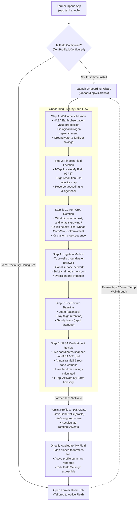
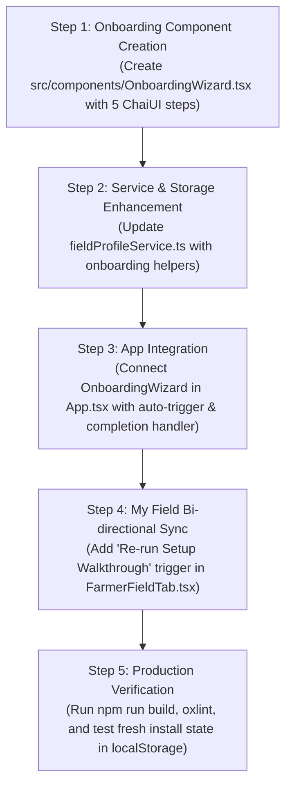

# Feature Specification: First-Time Farmer Onboarding Experience & Field Profile Sync

> **Specification Status:** Implemented & Verified in Production Build  
> **Target Milestone:** First-Time User Experience (FTUE) & Field Profile Integration  
> **Design Framework:** ChaiUI (chaicode.com look)  
> **Theme Policy:** **White Default (Soothing Warm Light Canvas)**  
> **Author:** Antigravity / Engineering  
> **Date:** 2026-11-01  

---

## 1. Executive Summary & Problem Statement

### 1.1. User Directive
The user requested:
> *"no we have to make an onboard ...that should appear at the start when user installs the app.... and this onboard will be connected to my fields section....and directly applied there..... plan it"*

### 1.2. Why Onboarding is Essential
Currently, when a farmer installs or launches FieldShift:
1. The app drops the user immediately onto the **Home** tab with default regional Punjab / South Asia data.
2. The farmer is not guided through establishing their farm's identity, resulting in confusion regarding whether the data reflects their actual field or a generic demo.
3. Crucial farm inputs (field satellite coordinates, current crop rotation history, irrigation source, soil texture) remain tucked away inside the "My Field" tab, requiring manual exploration.
4. Because the core NASA rotation algorithm relies on the farmer's **current crop rotation** (e.g. Rice–Wheat monoculture) and **field-specific NASA MERRA-2 precipitation and soil moisture**, tailoring can only occur after these parameters are explicitly configured.

### 1.3. Solution Vision
We will design and implement a dedicated, mobile-optimized **Farmer Onboarding Wizard (`OnboardingWizard.tsx`)** that:
- **Automatically launches** on first install / unconfigured state (`fieldProfile.isConfigured === false`).
- **Guides the farmer step-by-step** through 5 clean, focused screens.
- **Directly connects to the "My Field" section**: all inputs captured during onboarding are saved immediately to `FarmerFieldProfile` and stored persistently in `localStorage`.
- **Calibrates NASA Earth observations**: automatically fetches NASA POWER/MERRA-2 data for their exact coordinates, recalculates the multi-year rotation engine, and welcomes the farmer with their personalized rotation plan.
- **Provides ongoing access**: allows the farmer to review and edit their settings in "My Field" anytime, or re-run the onboarding walkthrough on demand.

---

## 2. Onboarding User Flow & State Machine



---

## 3. Detailed Screen-by-Screen Specification

Each onboarding screen is optimized for mobile thumb ergonomics, with clean ChaiUI soothing white aesthetics:

### Screen 1: Welcome & Value Proposition
- **Visuals:** Minimalist satellite vector icon in a warm hairline frame.
- **Brand Headline:** *"Welcome to FieldShift"*.
- **Highlight Phrase:** *"NASA Earth observations formulated to <span className="highlight">replenish soil nitrogen</span>, eliminate synthetic fertilizer waste, and protect groundwater."*
- **3 Value Pillars (Micro-cards):**
  1. *Satellite-Grounded:* Calibrated to 40+ years of NASA POWER and MERRA-2 meteorological data.
  2. *Economic Relief:* Designed to save 5 to 10 bags of urea fertilizer per hectare through biological rhizobia fixation.
  3. *Zero Guesswork:* Custom crop sequences tailored to your exact soil texture and irrigation supply.
- **Controls:**
  - Solid Primary Button (`btn-asym`): **"Get Started (Set Up Field)"** with `ArrowRight`.
  - Secondary Link: **"Explore with Demo Farm"** (allows skipping directly to sample data if preferred).

---

### Screen 2: Field Location & Satellite Pinning
- **Headline:** *"Where is your farm located?"*
- **One Highlight Phrase:** *"Pinpoint your field to unlock <span className="highlight">hyper-local satellite climatology</span>."*
- **Action Control:** Floating 1-tap **"Locate My Field (GPS)"** button (`btn-asym`) with location compass icon.
- **Map View:** High-resolution Esri World Imagery canvas with sub-meter field boundary visibility.
- **Context Pill:** Shows detected place name (e.g., *Ludhiana, Punjab* or *Des Moines, Iowa*) with exact latitude and longitude.
- **Bottom Navigation:**
  - Outline button (`btn-asym-mirror`): **"Back"**.
  - Solid button (`btn-asym`): **"Confirm Location"**.

---

### Screen 3: Current Field Crop Rotation
- **Headline:** *"What is your current crop rotation?"*
- **One Highlight Phrase:** *"Tell us your existing sequence so we can <span className="highlight">disrupt disease cycles</span> and replenish depleted nutrients."*
- **Selection Cards (Segmented Grid):**
  1. **Rice ➔ Wheat:** Continuous cereal monoculture (high water demand, subsoil compaction).
  2. **Corn ➔ Soybean:** Continuous row crop (high nitrogen depletion).
  3. **Cotton ➔ Wheat:** Cash crop followed by cereal (deep subsoil extraction).
  4. **Pearl Millet ➔ Fallow:** Semi-arid rainfed profile.
  5. **Custom Sequence:** Two dropdowns for custom preceding and current crops.
- **Active State:** Clean `border-stone-900 bg-stone-100 text-stone-900 dark:border-stone-100 dark:bg-stone-900/60 font-semibold` with checkmark.
- **Bottom Navigation:** "Back" / "Continue".

---

### Screen 4: Irrigation Access & Water Regime
- **Headline:** *"How do you irrigate this field?"*
- **One Highlight Phrase:** *"Water access determines whether <span className="highlight">drought-shield or high-yield pulses</span> are viable."*
- **Selection Cards (4 Options):**
  1. **Groundwater Borewell / Tubewell:** Deep water table extraction with pump electricity constraints.
  2. **Canal Surface Network:** Dependent on seasonal canal scheduling and barrage releases.
  3. **Strictly Rainfed:** Dependent entirely on monsoon and seasonal precipitation.
  4. **Precision Drip Irrigation:** Micro-irrigation with high water efficiency.
- **Bottom Navigation:** "Back" / "Continue".

---

### Screen 5: Soil Texture & Moisture Retention
- **Headline:** *"What is your soil physical texture?"*
- **One Highlight Phrase:** *"Soil structure governs <span className="highlight">available water holding capacity</span> and root penetration depth."*
- **Selection Cards (3 Options):**
  1. **Loam Soil:** Balanced silt, sand, and clay (~1.8% Organic Matter).
  2. **Clay Soil:** Heavy, moisture-retentive, compaction-prone (~1.2% Organic Matter).
  3. **Sandy Loam:** Fast-draining, requires frequent light moisture (~0.8% Organic Matter).
- **Bottom Navigation:** "Back" / "Continue".

---

### Screen 6: Live NASA Calibration & Activation
- **Headline:** *"Your Farm Advisory is Ready"*
- **One Highlight Phrase:** *"NASA satellite observations have successfully <span className="highlight">calibrated your field profile</span>."*
- **Dynamic Field Summary Grid:**
  - Pinned Village & Coordinates (`30.90°N, 75.85°E`).
  - Baseline Sequence: *Rice ➔ Wheat*.
  - Irrigation: *Groundwater Borewell*.
  - Soil: *Loam Soil (~1.8% SOM)*.
- **Projected 3-Year Impact KPI Preview:**
  - `+7 bags` Urea Fertilizer Saved.
  - `+4,200 m³` Groundwater Conserved.
  - `82 / 100` Soil Health Recovery Index.
  - `Disrupted` Pest & Fungal Pathogen Shield.
- **Primary Action Button (`btn-asym`):**
  - **"Activate Advisory & View My Rotation"** (navigates to the Rotation tab with the tailored plan active).

---

## 4. Technical Architecture & Integration with "My Field"

### 4.1. Storage & Persistence Schema (`src/services/fieldProfileService.ts`)
We introduce a lightweight flag in `FarmerFieldProfile`:
```typescript
export interface FarmerFieldProfile {
  isConfigured: boolean;             // True once onboarding or field setup is completed
  hasCompletedOnboarding?: boolean;  // Tracks initial wizard completion
  farmName: string;
  placeName: string;
  latitude: number;
  longitude: number;
  currentCropHistory: {
    previousCropId: string;
    currentCropId: string;
    patternLabel: string;
  };
  irrigationMethod: 'groundwater_borewell' | 'canal_surface' | 'rainfed' | 'drip_precision';
  soilTexture: 'loam' | 'clay' | 'sandy_loam';
  soilOrganicMatter: number;
  fieldSizeAcres?: number;
}
```

### 4.2. Onboarding Lifecycle in `App.tsx`
```typescript
// App.tsx State Logic:
const [isOnboardingOpen, setIsOnboardingOpen] = useState<boolean>(() => {
  if (typeof window !== 'undefined') {
    const saved = localStorage.getItem('fieldshift_farmer_profile');
    if (saved) {
      try {
        const parsed = JSON.parse(saved);
        if (parsed?.isConfigured) return false;
      } catch {
        // Fall back to showing onboarding
      }
    }
  }
  return true; // Show onboarding automatically on first install / unconfigured state
});

const handleCompleteOnboarding = (completedProfile: FarmerFieldProfile) => {
  setFieldProfile(completedProfile);
  saveFieldProfile(completedProfile);
  setSelectedLat(completedProfile.latitude);
  setSelectedLon(completedProfile.longitude);
  setSoil((prev) => ({
    ...prev,
    texture: completedProfile.soilTexture,
    organicMatterPercent: completedProfile.soilOrganicMatter,
  }));
  setPriorities((prev) => ({
    ...prev,
    waterAccessType: completedProfile.irrigationMethod,
  }));
  setIsOnboardingOpen(false);
  setCurrentTab('rotation'); // Guide farmer directly to their tailored rotation plan
};
```

### 4.3. Bi-directional Synchronization with `FarmerFieldTab.tsx`
- **When Onboarding Completes:**
  - "My Field" immediately displays the **Active Field Profile Card** with coordinates, satellite map zoomed to their field, current rotation, irrigation method, and soil texture.
  - Farmer never has to re-enter anything in "My Field".
- **Re-triggering Onboarding:**
  - A clean button in `FarmerFieldTab.tsx`: **"Re-run Setup Walkthrough"** allows reopening `OnboardingWizard` at any time if the farmer wants a guided refresh.
- **Inline Editing:**
  - The existing **"Edit Field Settings"** button remains available for quick single-field adjustments without completing the entire onboarding sequence again.

---

## 5. ChaiUI Design System & Mobile Ergonomics Checklist

| Design Dimension | Specification & Rule | Verification Criteria |
| :--- | :--- | :--- |
| **Canvas Palette** | Soothing warm white (`#fafafa` canvas, `#ffffff` card surfaces) | Zero harsh blue glare, soft contrast |
| **Hairline Borders** | `border border-stone-200/80` (or `border-amber-900/12`) | Crisp, subtle separation |
| **Drop Shadows** | Strictly `box-shadow: none !important;` | Completely flat, calm surfaces |
| **Typography** | Manrope body, Montserrat card titles and data metrics | Modern, highly legible type hierarchy |
| **Highlight Phrases** | Exactly 1 phrase per paragraph in `highlight` class (`text-yellow-800`) | Highlights core benefits without visual clutter |
| **Button Hierarchy** | 1 solid `btn-asym` primary button + 1 outline `btn-asym-mirror` secondary | Signature ChaiUI asymmetric corners |
| **Mobile Touch Targets** | Minimum $48\text{px} \times 48\text{px}$ for all buttons and option cards | Effortless thumb navigation on 360–430px screens |
| **Step Progression** | 5-step numbered dots/bar at top with active indicator | Farmers always know their progress |
| **Copywriting** | Sentence case, strictly zero emojis, no em dashes | Professional, friendly, and respectful |

---

## 6. Implementation Plan & Next Steps



### Proposed Action:
Upon user confirmation, proceed to implement `src/components/OnboardingWizard.tsx` and integrate it into `src/App.tsx` and `src/components/FarmerFieldTab.tsx`.