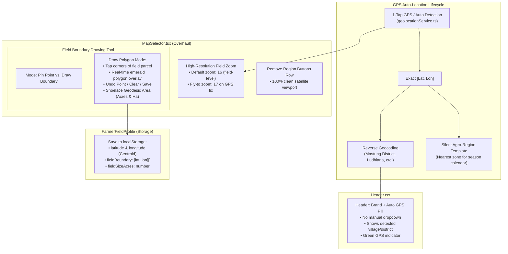

# Feature Specification: Automatic GPS Location, Field Boundary Polygon Drawing & High-Zoom Satellite Map

> **Specification Status:** Implemented & Verified in Production Build  
> **Target Scope:** Header Simplification, MapSelector Overhaul, Field Boundary Polygon Tool, High-Res Zoom  
> **Design Framework:** ChaiUI (chaicode.com look)  
> **Theme Policy:** **White Default (Soothing Warm Light Canvas)**  
> **Author:** Antigravity / Engineering  
> **Date:** 2026-11-01  

---

## 1. Problem Statement & User Directive

### 1.1. User Feedback
The user provided screenshots of:
1. The **Header region dropdown** (`media_1793484058340_8dc64bf6.png`): manual select list with "South Asia", "US Midwest Corn Belt", "Sub-Saharan Africa", "Mediterranean Basin", "Latin America", "Australia".
2. The **MapSelector region buttons** (`media_1793484082940_eca8c9a0.png`): "Regions: South Asia, US Midwest Corn Belt, Sub-Saharan Africa...".

And instructed:
> *"remove these manual location settings.....as the location will be selected by gps automatically..... and there should be option of select the fields properly and drawing on the maps....properly....and map must appear zoom in"*

### 1.2. Pain Points Identified
1. **Redundant Manual Macro-Regions:** Presets like "South Asia" or "Australia" feel like a demo prototype rather than a farmer utility. Real farmers have a specific plot of land and don't pick continents from a dropdown. Location must be driven automatically by device GPS with reverse geocoding to their village/district.
2. **Map Zoom Too Far Out:** Leaflet initializes at continent zoom (`zoom: 6`), forcing farmers to manually pinch-zoom 10+ times to find their village and field.
3. **Lack of Field Delineation / Drawing:** Farmers cannot outline their actual parcel boundaries. Without polygon drawing, they can only place a single point pin, which doesn't reflect actual farm size, shape, or acreage.

---

## 2. Technical Architecture & Component Changes



---

## 3. Detailed Specifications

### 3.1. Header Simplification (`src/components/Header.tsx`)
- **Remove:** The `<select>` element containing macro-regions (`South Asia`, `US Midwest`, etc.).
- **Add:** A clean, compact **Auto GPS Location Badge**:
  - Displays `placeName` (e.g. `Mastung District, Balochistan` or `Ludhiana, Punjab`).
  - Small pulsing emerald dot + `MapPin` icon.
  - Clicking it triggers a smooth re-centering on their farm.
  - Zero manual continent dropdowns.

### 3.2. Map High-Resolution Zoom (`src/components/MapSelector.tsx`)
- **Default Initial Zoom:** Set Leaflet `zoom: 16` (instead of `zoom: 6`).
  - At zoom 16 on Esri World Imagery, individual crop fields, irrigation canals, and tubewell sheds are immediately visible.
- **GPS Fly-To Zoom:** `map.flyTo([lat, lon], 17, { duration: 1.5 })` for razor-sharp parcel focus.

### 3.3. Removal of Manual Region Pills (`src/components/MapSelector.tsx`)
- Remove the `Regions: [South Asia] [US Midwest] ...` button row completely.
- Agro-ecological regional classification happens automatically in the background via `findNearestAgroRegion(lat, lon, allRegions)` to supply seasonal rainfall windows and crop calendar templates without requiring manual user selection.

### 3.4. Interactive Field Boundary Polygon Drawing Tool
- **Interaction Modes:**
  1. **Pin Point Mode (Default):**
     - Single tap sets field center pin.
     - Displays existing polygon if previously drawn.
  2. **Draw Boundary Mode (`draw`):**
     - Activated via a prominent button: **"Draw field boundary"** with `PenTool` / `Polygon` icon.
     - Farmer taps corners around their field parcel directly on the high-resolution satellite imagery.
     - Each tap places a circular vertex handle and draws an SVG polygon line connecting the vertices.
     - For $\ge 3$ vertices, it renders a closed semi-transparent emerald polygon (`#10b981` at 25% fill opacity, `#059669` 2.5px border).
- **Real-Time Geodesic Acreage Calculation:**
  - Using planar equirectangular projection centered at parcel latitude:
    $$x_i = (lon_i - lon_0) \times \frac{\pi}{180} \times R \times \cos\left(lat_0 \times \frac{\pi}{180}\right)$$
    $$y_i = (lat_i - lat_0) \times \frac{\pi}{180} \times R$$
    $$\text{Area} = \frac{1}{2} \left| \sum_{i=0}^{n-1} (x_i y_{i+1} - x_{i+1} y_i) \right| \quad (\text{in } \text{m}^2)$$
  - Converts square meters to acres ($\div 4046.86$) and hectares ($\div 10000$).
  - Live metric pill: `Field Area: 4.8 acres (1.9 ha)`.
- **Drawing Controls:**
  - **Undo:** Deletes the most recent vertex.
  - **Clear:** Clears the polygon.
  - **Save Field Boundary:** Saves vertices into `fieldProfile.fieldBoundary`, updates `fieldProfile.fieldSizeAcres`, computes polygon centroid as `latitude` and `longitude`, and returns to view mode.

---

## 4. Data Model Update (`src/types/index.ts`)

```typescript
export interface FarmerFieldProfile {
  isConfigured: boolean;
  hasCompletedOnboarding?: boolean;
  farmName: string;
  placeName: string;
  latitude: number;
  longitude: number;
  currentCropHistory: {
    previousCropId: string;
    currentCropId: string;
    patternLabel: string;
  };
  irrigationMethod: 'groundwater_borewell' | 'canal_surface' | 'rainfed' | 'drip_precision';
  soilTexture: 'loam' | 'clay' | 'sandy_loam';
  soilOrganicMatter: number;
  fieldSizeAcres?: number;
  fieldBoundary?: [number, number][]; // Array of [latitude, longitude] polygon vertices
}
```

---

## 5. Verification Checklist

1. **Header Verification:** Macro-region dropdown is gone; real farm district/village is displayed with auto GPS indicator.
2. **MapSelector Verification:** Region buttons row is gone.
3. **Zoom Verification:** Map loads at zoom 16 (field-level satellite imagery); GPS flies to zoom 17.
4. **Drawing Tool Verification:**
   - Farmer can toggle into "Draw field boundary" mode.
   - Tapping on satellite map drops vertices and draws an emerald polygon.
   - Real-time area badge calculates acres and hectares accurately.
   - "Undo", "Clear", and "Save boundary" function smoothly.
   - Saved polygon persists to `localStorage` and remains rendered on the map.
5. **Build & Lint Verification:** `npm run build` and `npm run lint` pass with 0 errors.
