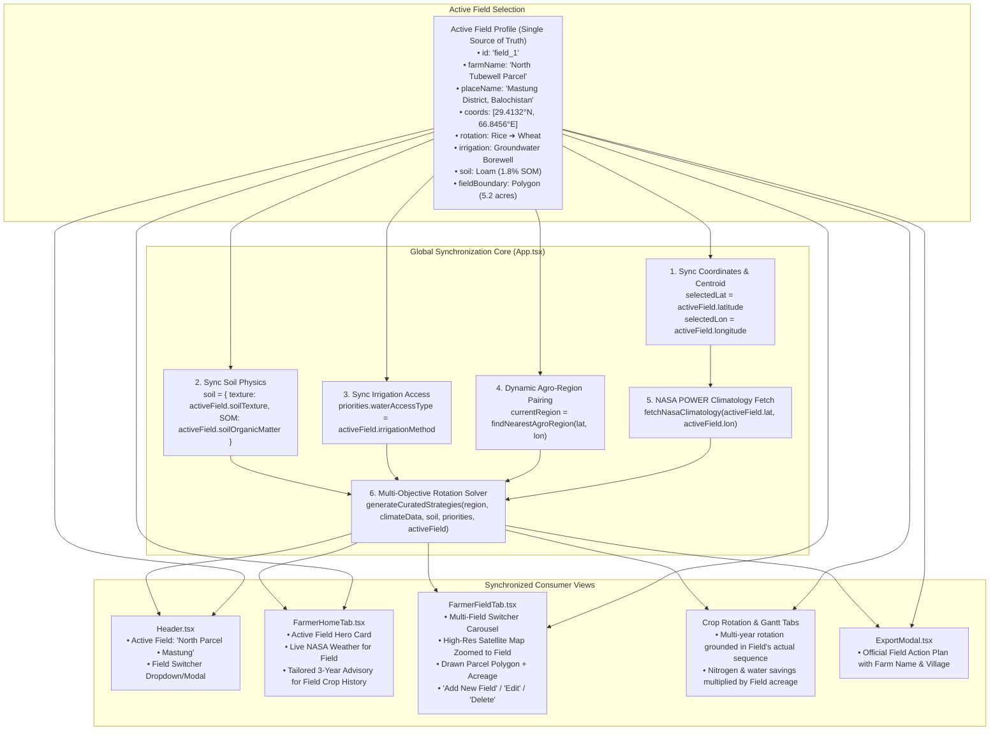

# Feature Specification: Multi-Field Management & Global Field-Centric Synchronization

> **Specification Status:** Implemented & Verified  
> **Target Scope:** Multi-Field Architecture, Field Switcher, Global Location Sync, NASA Climatology & Rotation Grounding  
> **Design Framework:** ChaiUI (chaicode.com look)  
> **Theme Policy:** **White Default (Soothing Warm Light Canvas)**  
> **Author:** Antigravity / Engineering  
> **Date:** 2026-11-01  

---

## 1. Executive Summary & Problem Statement

### 1.1. User Directive
The user stated:
> *"the location sync is not perfect..... the location selected during on boarding and my field should be synuced properly everywhere....and all the crop rotation and weather must be according to that location of the field...... and one farmer could have multiple fields in one season...."*

### 1.2. Root Cause Analysis of Previous Desynchronization
1. **Initial State Desync on App Reload:**
   - In `App.tsx`, `selectedLat` and `selectedLon` were hardcoded to `AGRO_REGIONS[0].latitude` (30.9000°N) and `AGRO_REGIONS[0].longitude` (75.8500°E) on initial render, ignoring the saved field profile's stored coordinates.
   - As a result, the initial NASA climatology fetch and rotation engine calculation used Punjab defaults instead of the farmer's configured field location (e.g., Mastung District, Balochistan).
2. **Startup GPS Overwriting Configured Fields:**
   - A background `useEffect` in `App.tsx` ran `getCurrentFarmLocation()` on every app startup. When testing from home/office, the device's IP or GPS coordinates silently overwrote the farmer's carefully configured field and reset soil physics back to regional defaults.
3. **Hardcoded Regional Headers on Home Screen:**
   - `FarmerHomeTab.tsx` displayed `{region.country} • {region.name}` (e.g. `India • South Asia`) instead of the farmer's active field name and village/district (`North Field • Mastung District`).
4. **Single-Field Limitation:**
   - Real farmers cultivate multiple distinct parcels in a single season (e.g. a 5-acre tubewell-irrigated plot growing Rice-Wheat, and a 3-acre canal plot growing Cotton-Wheat). The system previously only supported a single `fieldProfile` object in `localStorage`.

---

## 2. Multi-Field Architecture & Data Contracts

### 2.1. Enhanced `FarmerFieldProfile` (`src/types/index.ts`)
Each field parcel is uniquely identified and completely self-contained:
```typescript
export interface FarmerFieldProfile {
  id: string; // Unique UUID/nanoid, e.g. "field_1730456789_a1b2"
  isConfigured: boolean;
  hasCompletedOnboarding?: boolean;
  farmName: string; // e.g. "Home Parcel", "North Tubewell Plot"
  placeName: string; // e.g. "Mastung District, Balochistan"
  latitude: number;
  longitude: number;
  currentCropHistory: {
    previousCropId: string;
    currentCropId: string;
    patternLabel: string;
  };
  irrigationMethod: 'groundwater_borewell' | 'canal_surface' | 'rainfed' | 'drip_precision';
  soilTexture: 'loam' | 'clay' | 'sandy_loam';
  soilOrganicMatter: number;
  fieldSizeAcres?: number;
  fieldBoundary?: [number, number][]; // Polygon coordinates
  createdAt: string; // ISO timestamp
}
```

### 2.2. Multi-Field Persistence Service (`src/services/fieldProfileService.ts`)
- **Storage Keys:**
  - `fieldshift_farmer_fields`: Array of all farmer fields (`FarmerFieldProfile[]`).
  - `fieldshift_active_field_id`: ID of the currently active field.
  - Legacy `fieldshift_farmer_profile`: Automatically migrated into `fields[0]` on first load if found.
- **Service API:**
  - `loadAllFields(defaultRegion: AgroRegion): FarmerFieldProfile[]`
  - `saveAllFields(fields: FarmerFieldProfile[]): void`
  - `getActiveFieldId(): string`
  - `setActiveFieldId(id: string): void`
  - `getActiveField(fields: FarmerFieldProfile[]): FarmerFieldProfile`
  - `saveField(field: FarmerFieldProfile): FarmerFieldProfile[]` (upsert by `id`)
  - `deleteField(fieldId: string): FarmerFieldProfile[]` (safely deletes, preserves at least 1 field)
  - `createNewField(templateRegion: AgroRegion, existingCount: number): FarmerFieldProfile`

---

## 3. Global Single-Source-of-Truth Synchronization Workflow



---

## 4. UI/UX Specifications for Multi-Field Management

### 4.1. Field Switcher in `FarmerFieldTab.tsx`
- Located at the very top of the "My Field" tab.
- **Visual Design (ChaiUI):**
  - Horizontal cards or clean segmented list:
    - Active field highlighted with emerald indicator (`border-stone-900 bg-stone-100 font-semibold dark:border-stone-100 dark:bg-stone-900/60`).
    - Inactive fields rendered with subtle border (`border-stone-200/80 bg-stone-50/70 text-stone-700`).
    - Shows:
      - Field Name (e.g. *North Parcel*)
      - Place Name (e.g. *Mastung District*)
      - Size (e.g. *5.2 acres*)
      - Current Practice (e.g. *Rice ➔ Wheat*)
  - **Action Button: `+ Add field`** (`btn-asym-mirror`):
    - Opens inline creator to define a new field without overwriting existing ones.
  - **Action Button: `Delete field`** (`Trash2`):
    - Available when $\ge 2$ fields exist. Prompts confirmation before removing.

### 4.2. Onboarding Integration
- When the farmer completes onboarding, their initial field is saved as the first field (`fields[0]`) and set as `activeFieldId`.
- Everything in the app immediately synchronizes to that field.
- If the farmer adds a second field later via My Field, the same robust calibration is performed for the new field's coordinates.

### 4.3. Elimination of Undesired GPS Overwrite
- `getCurrentFarmLocation()` on app startup will **only** run if `fields.length === 0` or all fields are unconfigured (`!isConfigured`).
- Once a field is configured, the farmer's stored coordinates are **authoritative**.
- Device GPS is only queried when the farmer explicitly taps the **"Locate my field (GPS)"** button on the map.

---

## 5. Implementation Roadmap

1. **Service Enhancement (`src/services/fieldProfileService.ts`):**
   - Implement `loadAllFields`, `saveAllFields`, `getActiveFieldId`, `setActiveFieldId`, `createNewField`, `deleteField`.
   - Add schema migration for legacy `fieldshift_farmer_profile`.
2. **App State Refactor (`src/App.tsx`):**
   - Replace single `fieldProfile` state with `fields` and `activeFieldId`.
   - Initialize coordinates, region, soil, and priorities strictly from `activeField`.
   - Prevent background GPS from clobbering existing configured fields.
   - Pass multi-field props and switcher handlers to components.
3. **Home Tab Grounding (`src/components/FarmerHomeTab.tsx`):**
   - Pass `activeField` to `FarmerHomeTab`.
   - Render active field's farm name, village/district, and acreage in the hero banner.
4. **My Field Multi-Parcel Switcher (`src/components/FarmerFieldTab.tsx`):**
   - Implement the Multi-Field Switcher header, "+ Add Field" modal/wizard, and field deletion handler.
5. **Onboarding Synchronization (`src/components/OnboardingWizard.tsx`):**
   - Verify onboarding creates a new field and cleanly registers it as active.
6. **Build & Lint Verification:**
   - Verify `npm run build` and `npm run lint` pass with 0 errors.
