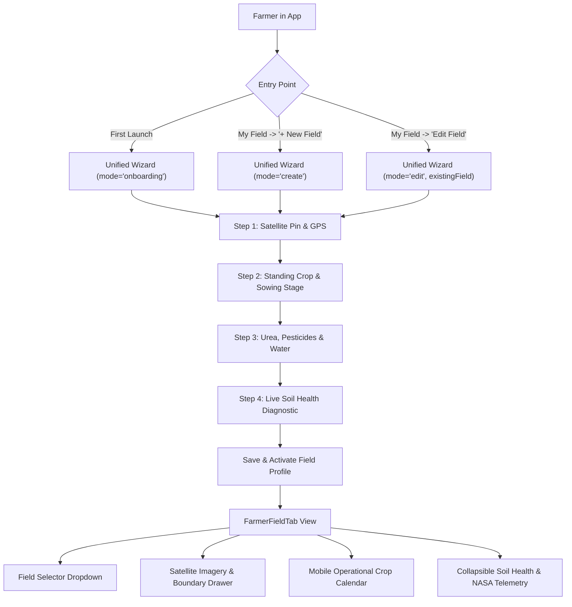

# Feature Specification 27: Mobile-Optimized Crop Calendar & Unified Interchangeable Field Wizard

## 1. Executive Summary
This milestone addresses critical mobile feedback from Android physical testing:
1. **Home Page Mobile Optimization**: Resolved uncentered and overflowing elements by correcting Tailwind CSS v4 breakpoints (`@theme { --breakpoint-xs: 380px; }`), aligning action buttons into a balanced 3-column row, centering atmospheric condition cards, and clamping satellite coordinate badges.
2. **Mobile Operational Crop Schedule (`CropRotationCalendar.tsx`)**: Re-architected into a clean chronological overview:
   - **Eliminated the Awkward Horizontal Gantt Canvas**: Completely removed the squished 12-month bar chart, floating duration bars, and dashed buffer boxes that collided and clipped on mobile screens.
   - **Chronological Date Overview**: Replaced with clean, full-width seasonal phase cards ordered strictly by exact calendar dates (Sowing Window, Duration in Days, Harvest Window, Water Requirement, and Nitrogen Impact).
   - **10-Day Land Prep & Rauni Connectors**: Cleanly delineated 10-day transition intervals between crop seasons for residue management and pre-sowing soaking irrigation.
   - **Interactive Operational Guidance**: Tapping any seasonal phase updates the 4 operational milestone cards (*Land Preparation*, *Sowing Window*, *Water Need*, *Harvest Window*) with exact dates and checklists.
3. **Standardized & Interchangeable Field Setup with Satellite View & Boundary Drawer (`OnboardingWizard.tsx` & `FarmerFieldTab.tsx`)**:
   - Transformed the onboarding wizard into a universal, interchangeable **Field Setup Wizard** supporting `mode="onboarding" | "create" | "edit"`.
   - **Integrated Sub-Meter Satellite Map & Boundary Drawer**: Embedded `MapSelector` directly into Step 1 of the wizard so farmers visually see their satellite imagery and can draw their field polygon boundaries (with acreage calculation).
   - **Removed Manual Region Select Dropdown**: Completely stripped out the macro-region `<select>` dropdown (`South Asia`, `Punjab`, etc.) and duplicate GPS buttons. The wizard now relies exclusively on GPS auto-detection or direct map tapping.
   - Unified the "My Field" addition and editing experience with the exact same 4-step wizard (Satellite Pinning & Boundary Drawing, Standing Crop & Stage, Field Inputs & Water, Soil Health Diagnostic).
4. **Integration of Crop Calendar in "My Field" (`FarmerFieldTab.tsx`)**: Placed the personalized crop calendar front and center in the "My Field" tab so farmers can inspect their operational schedule for each parcel directly alongside satellite imagery.

---

## 2. Problem Statement & Mobile Field UX Analysis

### A. Calendar Mobile Distortion
- On screens <= 390px, dividing the timeline into 12 grid columns forced each month into ~26px width. Buttons containing crop images (32px) and text overflowed or clipped.
- **Solution**: 
  - Horizontally scrollable canvas (`min-w-[580px]`) with responsive month widths.
  - Companion mobile vertical progression cards that lay out standing and rotation crops sequentially.

### B. Inconsistent Field Addition & Editing Experience
- The app previously had two divergent ways to manage a field:
  - First-time onboarding used a 4-step wizard with soil diagnostic and input calibration.
  - "My Field" had an inline form with different controls and missing telemetry feedback.
- **Solution**:
  - Unified `OnboardingWizard` to serve all 3 modes: `onboarding`, `create`, and `edit`.
  - In `FarmerFieldTab`, tapping "+ New field" or "Edit field" opens this identical wizard, ensuring that parcel names, boundaries, fertilizer inputs, and soil health scores are calculated with exact parity.

---

## 3. Architecture & Data Flow

---

## 4. Modified Components

1. **`src/index.css`**: Added `@theme { --breakpoint-xs: 380px; }` to support fine-grained mobile grid layouts in Tailwind CSS v4.
2. **`src/components/CropRotationCalendar.tsx`**:
   - Wrapped 12-month visual timeline in `overflow-x-auto` with `min-w-[580px]`.
   - Added swipe hint badge for mobile screens.
   - Built the mobile-first vertical season progression card list with 10-day prep badges, active indicators, and interactive selection.
   - Re-organized operational milestones into a responsive 2x2 grid on mobile.
3. **`src/components/OnboardingWizard.tsx`**:
   - Generalized into a reusable multi-mode wizard (`WizardMode = 'onboarding' | 'create' | 'edit'`).
   - Supports pre-filled data via `existingField?: FarmerFieldProfile`.
   - Added custom parcel name editing in Step 1.
   - Tailored header titles and action buttons depending on the active mode.
4. **`src/components/FarmerFieldTab.tsx`**:
   - Standardized field addition and editing to use the unified `OnboardingWizard`.
   - Embedded `CropRotationCalendar` directly within the tab layout.
   - Enhanced the compact field dropdown switcher with "+ Add another field parcel".
5. **`src/App.tsx`**:
   - Passed `activeStrategy` and `climateData` into `FarmerFieldTab`.
   - Connected unified wizard events to global state.

---

## 5. Verification & Validation
- **Vite Production Build**: `npm run build` compiled 1,925 modules in 1.27s with zero TypeScript warnings or errors.
- **Capacitor Android Sync**: Assets copied and plugins synced in 0.219s.
- **Android APK Assembly**: Built debug APK (`FieldShift-debug.apk`) using JDK 21 and Gradle daemon.
- **Design Guidelines**: Adheres to ChaiUI styling (#0a0a0a background, flat cards, 1px warm hairlines, zero emojis, high-contrast typography).
